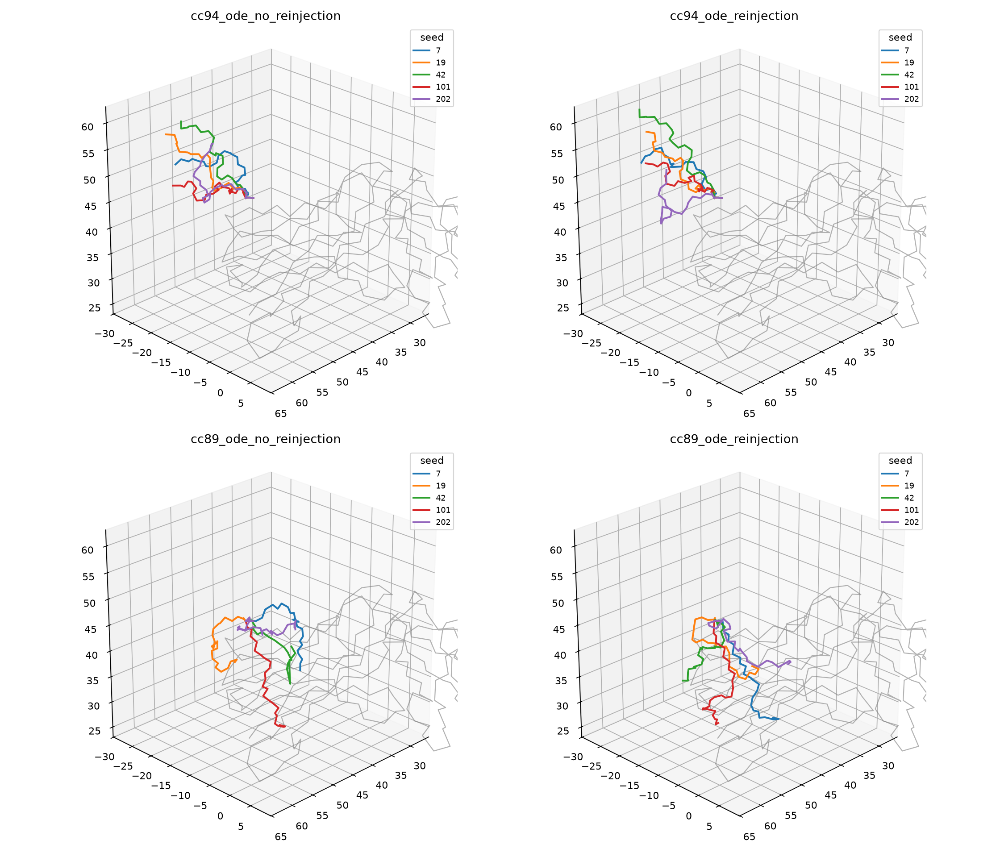
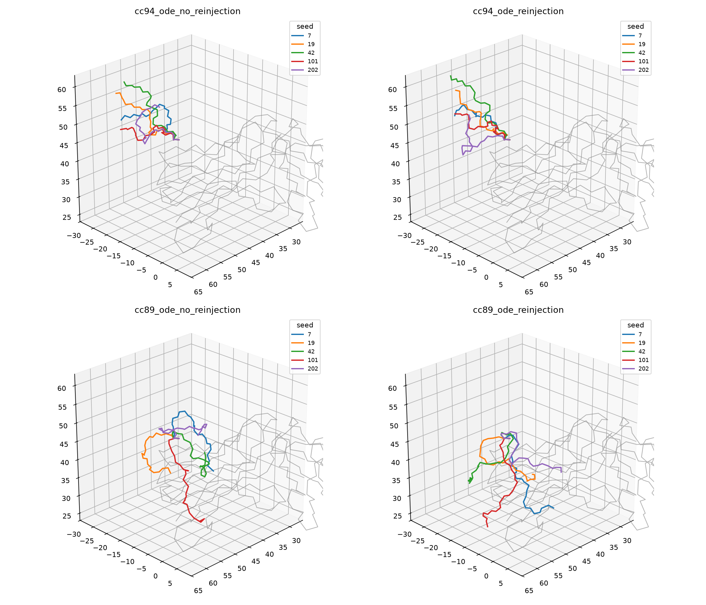

# 9CQD: multichain cc94 versus monomer-only cc89

Date: 2026-10-27. Status: completed Linux/CUDA research pilot.
Branch: `research/9cqd-protpardelle-multichain`, started from main `f54e494`.

**Result:** on the crowded N-terminal gap **M155–M162**, Protpardelle-1c
**cc94_epoch3100** passed every recorded geometry and chemical-exclusion clash
gate after generated-only refinement in **5/5 seeds without reinjection and
5/5 with reinjection**. Matched cc89 ODE controls passed **1/5** and **0/5**.

This strengthens the hypothesis that the earlier interpenetration depends on
the selected model and its training/conditioning domain. It does not isolate
multichain training from positional encoding, task masking, ghost-atom filling
and other checkpoint differences. It is not general terminal-gap qualification.

## Scope and comparison design

This tests **one eight-residue N-terminal tail**, not every missing tail/gap in
9CQD. Sequence **MGSKPNND** is generated with only the right anchor **M163**.
The observed antibody chain X includes neighboring loops X28–34, X51–54 and
X72–79. The deposited structure has no experimental coordinates for the tail;
the endpoint is physical plausibility and avoidance of interpenetration, not
accuracy against a native tail.

The exact single-gap request and context from the
[previous Protenix/cc89 study](9cqd-protenix-cc89-comparison.md) were reused:

- **58 generated heavy atoms**, **3,441 fixed observed heavy atoms**.
- **189 selected residue tokens**, **1,399 conditioning atoms**.
- Context spans in zero-based half-open target-sequence coordinates:
  M `[0,35)`; W `[3,6)`, `[22,25)`, `[28,40)`, `[88,105)`; X `[0,119)`.
- All original observed source atoms participate in final collision validation
  and refinement, including atoms outside the selected neural context.
- Fixed sequence, no MSA, no sequence redesign, no unrelated gap filling,
  no added contact/repulsion guidance, no anchor relaxation or solvent.

The authors [recommend starting new models with ODE sampling](https://github.com/ProteinDesignLab/protpardelle-1c/blob/ee378400f25b801fa481028000f9060183d7fb4c/README.md#search_spaceschurns)
and explicitly report poor quality with `s_churn=200` for multichain all-atom
models. Therefore **all four new cells used 500 updates, step_scale=1.0 and
s_churn=0**. The new cc89 controls distinguish a checkpoint effect from simply
changing the earlier cc89 schedule (step_scale=1.2, s_churn=200).

| Cell | Checkpoint | Per-update reinjection | Sequence position handling |
|---|---|---|---|
| N0 | cc94_epoch3100 | No | Native relative encoding, source-physical positions |
| N1 | cc94_epoch3100 | Yes | Native relative encoding, source-physical positions |
| B0 | cc89_epoch415 | No | Neutral rotary chain phase, source-physical positions |
| B1 | cc89_epoch415 | Yes | Neutral rotary chain phase, source-physical positions |

The source-physical position arrays retain three physical chains M/W/X and the
sequence separations of the discontiguous W fragments. Motif serialization uses
six proxy entities; the mapping is explicit and bijective. The cc89 rotary
neutral-phase intervention is **not** applied to cc94's relative encoding.

Seeds: **7, 19, 42, 101, 202**, one sample per cell/seed, plus independent seed-7
repeats in N1/B1: **20 primary + 2 repeats**. Four separate two-update hook smokes
were infrastructure checks and are excluded from the scientific denominator.
Seed 7 was run first, followed by expansion only after integrity checks passed.
All scientific sampling jobs completed on their first attempt; rejected geometry
was not retried or replaced.

## Deployment and checkpoint identity

The official [Zenodo model archive](https://zenodo.org/records/16817230) was
downloaded after the operator requested deployment. The 4,294,232,741-byte archive
matched the published MD5 `59fc043a9d981d6c74baa2d051ea164a`. Only the cc94
checkpoint and matching deployment configuration were extracted.

| Asset | Identity |
|---|---|
| Upstream engine | `ee378400f25b801fa481028000f9060183d7fb4c` |
| cc94 checkpoint SHA256 | `a58c009ead22b6f79ef61d44e258b432b0fada1dfd8d44cb7a137d7459038a15` |
| cc94 config SHA256 | `680096576f6bcec1da7e9c30a89c7278c04cf1ab16ed9a74c2cb99e37fa4db74` |
| cc94 checkpoint file | 301,344,516 bytes, including optimizer state |
| cc94 parameter count | 25,169,791; FP32 parameters ≈96.02 MiB |
| cc94 task | `ai-allatom-nomask` |
| cc94 ghost-atom filling | `CA`, `dummy_fill_masked_atoms=true` |
| cc94 deployment sigma_data | 10.38 |
| GPU | NVIDIA A100-SXM4-40GB |
| Sampling environment | Python 3.12.14, Torch 2.6.0+cu124, NumPy 2.4.6 |

Both checkpoints loaded with **strict state-dict matching**, not merely the
upstream loader's permissive `strict=False`. Sequence identity was checked against
the actual sampler output. Checkpoint, configuration and executed source hashes
were frozen before sampling. Public checkpoint locks and default profiles were
not modified; this is a case-bounded research adapter.

The available checkpoint file is larger than its parameter tensors because it
contains optimizer state. Both cc94 and cc89 measured roughly **288.26 MiB peak
PyTorch CUDA allocations** and **1.04 GiB peak sampling-process RSS** in this
189-token test. These measurements support the earlier memory feasibility
estimate for Apple Silicon, but **cc94 MPS operators and performance have not
been tested on a Mac**. CUDA allocations and host RSS are separate quantities,
not a forecast of exact unified-memory use.

## Raw geometry before OpenMM

Counts are per primary seed; repeats do not increase the denominator.

| Cell | M–X atom contact <1.9 Å | M–X backbone segments <0.5 Å | Any authoritative severe clash | All recorded gates pass |
|---|---:|---:|---:|---:|
| cc94 N0 | 2/5 | **0/5** | 5/5 | 0/5 |
| cc94 N1 | 2/5 | **0/5** | 5/5 | 0/5 |
| cc89 B0 | 5/5 | 2/5 | 5/5 | 0/5 |
| cc89 B1 | 5/5 | 2/5 | 5/5 | 0/5 |

An authoritative severe clash means overlap ≥0.90 Å after chemical bond/1–3/1–4
exclusions, with **no distance-inferred M–X covalent bonds**. Counts include
generated atoms against the full source and internal generated-region clashes,
not only M–X contacts. The unchanged repository steric scores are also retained.
For example, N0 seed 202 passed the repository raw gates but had three severe
contacts in the independent chemical-exclusion analysis; it is not counted as an
all-gate raw success.

cc94 raw junction C–N distances across both arms were **1.232–1.432 Å**, inside
the selected 1.20–1.45 Å interval. Its raw candidates still had local clashes or
bond/angle errors; none was counted as a complete raw geometry pass.



## After common generated-only refinement

Every raw candidate received the same generated-only OpenMM **Reference**
refinement: max_iterations=250, restart_count=8, perturbation=0.75 Å, sample seed.
There was no staged anchor release. All **22 refinements completed**, with no
raw-retained refinement failure. Existing observed coordinates remained exact.

| Cell | M–X atom contact <1.9 Å | M–X backbone segments <0.5 Å | Any authoritative severe clash | All recorded gates pass |
|---|---:|---:|---:|---:|
| cc94 N0 | **0/5** | **0/5** | **0/5** | **5/5** |
| cc94 N1 | **0/5** | **0/5** | **0/5** | **5/5** |
| cc89 B0 | 0/5 | 0/5 | 4/5 | 1/5 |
| cc89 B1 | 1/5 | 0/5 | 5/5 | 0/5 |

cc94's refined junction distances were **1.363–1.383 Å**. Bond/angle, amide,
Ramachandran, sidechain, chirality and severe-clash gates all passed in all ten
primary cc94 candidates. Both N1/B1 independent seed-7 repeats reproduced the
primary candidate PDB hashes exactly, raw and refined.



## Interpretation

The authors' [model table](https://github.com/ProteinDesignLab/protpardelle-1c/blob/ee378400f25b801fa481028000f9060183d7fb4c/README.md#available-models)
classifies cc94 as a 0.5/0.5 monomer/multichain model, versus monomer-only cc89.
The extracted configuration also lists the interface and monomer datasets with
mixing_ratios `[0.5, 0.5]`. Its `multichain_prob=0.0` setting is not evidence of
monomer-only training: it must not be confused with the explicit dataset mixture.

**The within-family experiment supports the model-selection hypothesis.** The
cc94 improvement persists with the same ODE schedule used for new cc89 controls.
Its backbone avoids the observed X loops much more consistently even before
refinement, and generated-only refinement resolves its remaining local defects.
The cc89 controls remain substantially worse; changing churn alone is not an
adequate explanation for the improvement.

It is still not a training-data-only intervention. cc94 differs in all-atom
masking, relative rather than rotary encoding, CA ghost filling, sigma_data and
weights. Reinjecting coordinates did not improve the final pass fraction of cc94
on these five seeds, whereas reinjection was important in the previous Protenix
experiment. That result is specific to the sampled tail and conditioning setup.

An open-tail near-crossing alarm is not a unique knot/link invariant. These
metrics establish the absence of the measured severe penetrations in the final
cc94 structures, not experimental native accuracy or universal absence of every
possible notion of threading. Other N/C-terminal gaps, larger contexts and
macOS/MPS remain untested.

## Reproduction and inspection

The executed research driver and metric source are tracked:

- [`scripts/cc94_9cqd_study.py`](../../scripts/cc94_9cqd_study.py)
- [`scripts/cc94_9cqd_metrics.py`](../../scripts/cc94_9cqd_metrics.py)
- [`scripts/analyze_cc94_9cqd.py`](../../scripts/analyze_cc94_9cqd.py)
- [Machine-readable results and protocol](9cqd-cc94-results.json)

Commands executed from the repository root, with the scientific interpreter:

```bash
PYTHONPATH=src python scripts/cc94_9cqd_study.py prepare
PYTHONPATH=src python scripts/cc94_9cqd_study.py smoke
PYTHONPATH=src python scripts/cc94_9cqd_study.py pilot
PYTHONPATH=src python scripts/cc94_9cqd_study.py expand
PYTHONPATH=.:src python -m scripts.analyze_cc94_9cqd
PYTHONPATH=.:src python -m scripts.cc94_9cqd_study refine-all
PYTHONPATH=.:src python -m scripts.analyze_cc94_9cqd
```

The driver records actual per-job Python paths, arguments, environment and
timeouts in `.artifacts/cc94-9cqd/logs/*.command.json`. Its defaults reference the
local existing pinned engine, handoff and scientific environments; this is not
a fresh-clone installer or a portable Mac runner. Neural generation needs the
separate Python 3.12 sampling environment. Refinement uses the core environment.
`refine-all` resumes saved raw outputs and does not resample. Attempts reject
overwriting; completed runs are reused by the matrix commands.

Full local evidence is below `.artifacts/cc94-9cqd/`: verified weights/config,
protocol, source mapping, requests, native coordinates, actual model position and
chain arrays, callback counts/devices, raw/refined results and logs. Checkpoints
and optimizer state are not committed.

**Visual inspection:** `gap_visual_review_9cqd_cc94/` contains all **44 candidate
PDBs**, source PDB, two overview PNGs, `files.json`, per-seed CSV, and
`inspect_raw.pml` / `inspect_refined.pml`. All structures share the source frame.
Run PyMOL from that directory; seed 7 is initially enabled for each arm.

## Production migration following the pilot

The [versioned cc94 integration](../../deploy/protpardelle-1c/cc94.md) replaces
automatic cc89 selection for new Protpardelle requests on CUDA and MPS. This
changes the explicit Protpardelle backend, not the default MODELLER backend.
cc89 remains explicit frozen-request replay only. Native MPS acceptance remains
pending; the CUDA pilot is not reclassified as MPS evidence.

The [additional seven-gap production smoke](cc94-production-seven-gap-smoke.json)
completed all sampling and refinement steps but was scientifically rejected for
one amide-planarity and one Ramachandran finding. Zero source displacement,
correct generated identities, zero detectable D-Cα and zero repository severe
clashes were recorded. This larger input was an operational/provenance check,
not a new accepted seed or a replacement for any pilot outcome.

The first production attempt stopped before sampling because the independent-gap
artifact reader imported refinement-only PDBFixer. Extracting that bounded reader
into a dependency-free shared module fixed the isolation issue without relaxing
its path, symlink, hardlink, size or digest checks.

The pilot's executed source snapshot is retained locally under
`.artifacts/cc94-9cqd/executed-source/`. Its original source hashes in the results
JSON refer to that pre-migration execution; the production adapter has since
changed. The frozen research runner intentionally rejects a changed execution
source rather than silently calling the changed adapter a replay.

Verification included 212 targeted production/context/refinement tests and a
non-slow suite with 1,595 passes plus six CLI subprocess tests passing on rerun
after adding the scientific environment's `bin` directory to PATH. Seven tests
were skipped for unavailable optional tools/dependencies. Ruff, agent/user docs,
deployment links and the generated GUI schema passed. Local Python 3.13 CLI-help
drift and scientific-environment mypy findings were compared against unchanged
main and were identical; CI's reference/type baseline is Python 3.11.
