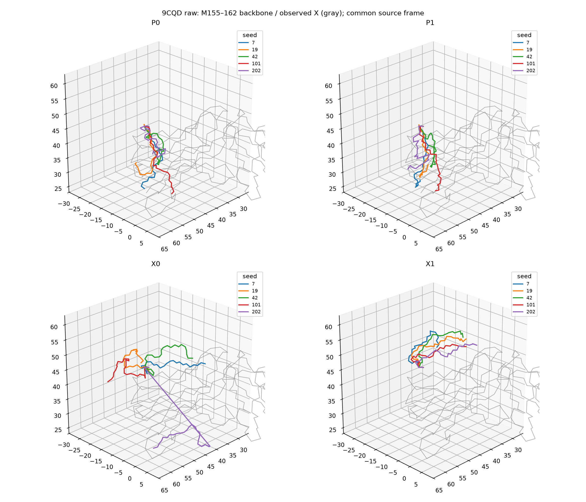
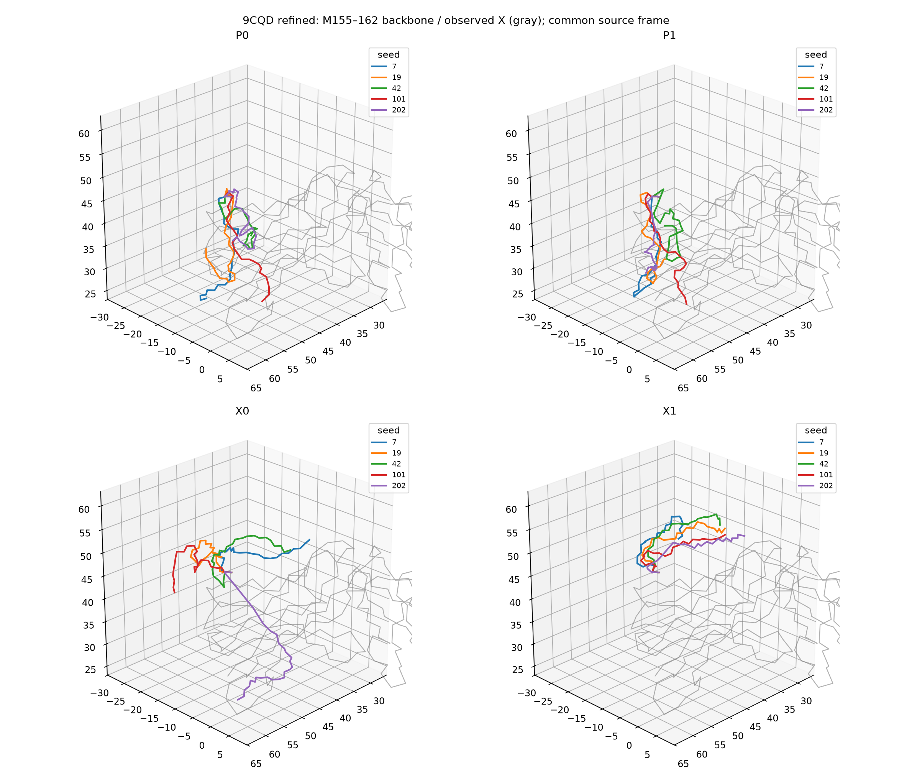

# 9CQD: Protenix v1 versus Protpardelle cc89 at a crowded terminal gap

Date: 2026-10-27. Status: completed case-specific Linux/CUDA research comparison.

**Finding:** Protenix v1 with per-update coordinate reinjection avoided the
severe tail/context interpenetration seen with cc89 on this case. After identical
generated-only OpenMM refinement, it passed all recorded geometry and clash gates
in **5/5 seeds**, versus **0/5** for cc89 with or without reinjection.

The training-domain difference is a plausible explanation: the authors classify
the tested **cc89_epoch415** checkpoint as monomer-only. This is not a limitation
of the entire Protpardelle-1c family, which also contains multichain checkpoints.
The experiment supports a backend/model × conditioning effect; it does not isolate
training data or weights from architecture and representation.

## Case and protocol

The generated region was chain **M155–M162**, sequence **MGSKPNND**, with only the
right anchor **M163**. The neighboring chain X includes the crowded loop regions
X28–34, X51–54 and X72–79. The primary question was whether the generated tail
interpenetrates this observed environment, not its accuracy against an unavailable
experimental tail structure.

- Exactly **58 generated heavy atoms**, **3,441 preserved observed heavy atoms**.
- Original selected context: **189 residue tokens / 1,399 conditioning atoms**.
- Context spans, in zero-based half-open target-sequence coordinates:
  M `[0,35)`; W `[3,6)`, `[22,25)`, `[28,40)`, `[88,105)`; X `[0,119)`.
- All original observed source atoms participated in collision analysis and
  refinement, including those outside the sampled context.
- Seeds **7, 19, 42, 101, 202**, one candidate per cell/seed. Independent seed-7
  repeats in P1 and X1: **20 primary + 2 repeat samples**.
- One NVIDIA A100-SXM4-40GB for serial generation. No MSA, sequence redesign,
  external guidance or additional generated gaps.

| Cell | Checkpoint | Per-update reinjection | Updates |
|---|---|---|---:|
| P0 | Protpardelle cc89_epoch415 | No | 500 |
| P1 | Protpardelle cc89_epoch415 | Yes | 500 |
| X0 | protenix_base_default_v1.0.0 | No | 200 |
| X1 | protenix_base_default_v1.0.0 | Yes | 200 |

cc89 used step_scale=1.2, s_churn=200, neutral chain phase and source-physical
position features. Protenix used one recycle, one sample, bf16, torch triangle and
layernorm kernels, and no cache/fusion. These are different native schedules,
not an equal-compute or controlled speed benchmark.

Common refinement used the same core environment and **OpenMM Reference**,
max_iterations=250, restart_count=8, perturbation=0.75 Å, and the matching sample
seed. Only the generated region moved; there was no observed-anchor relaxation,
solvent or whole-complex minimization.

## Raw results: generation, frame fitting and materialization, before OpenMM

Counts below use the five primary seeds; repeats are not independent seeds.

| Cell | Any M–X atom pair <1.9 Å | M–X backbone segment minimum <0.5 Å | Any authoritative severe clash | All recorded gates pass |
|---|---:|---:|---:|---:|
| P0 | 5/5 | 4/5 | 5/5 | 0/5 |
| P1 | 5/5 | 3/5 | 5/5 | 0/5 |
| X0 | 4/5 | 1/5 | 5/5 | 0/5 |
| X1 | 1/5 | 0/5 | 1/5 | 0/5 |

Here, an authoritative severe clash means vdW overlap ≥0.90 Å after chemical
bond/1–3/1–4 exclusions, without inventing M–X covalent bonds from proximity.
It includes generated atoms against the full observed source and clashes within
the generated region. It is broader than an M–X contact alone. The unchanged
repository steric scores are retained separately in the machine-readable data:
their distance-inferred exclusions can mask real penetrations.

X1 was not a complete raw geometry pass: its M162:C–M163:N junction distances
were **1.459–1.781 Å**, outside the preregistered 1.20–1.45 Å interval.

## After common generated-only refinement

All **22 refinements completed**, with no raw-retained refinement failure.

| Cell | Any M–X atom pair <1.9 Å | M–X backbone segment minimum <0.5 Å | Any authoritative severe clash | All recorded gates pass |
|---|---:|---:|---:|---:|
| P0 | 0/5 | 1/5 | 5/5 | 0/5 |
| P1 | 1/5 | 0/5 | 5/5 | 0/5 |
| X0 | 1/5 | 1/5 | 2/5 | 1/5 |
| X1 | **0/5** | **0/5** | **0/5** | **5/5** |

X1's refined junction distances were **1.368–1.393 Å**. Its remaining recorded
bond/angle, amide, Ramachandran, sidechain, chirality and clash gates also passed.
For cc89, refinement separated many atom pairs but did not produce an accepted
geometry in any primary seed. Absence of a <1.9 Å atom pair alone was therefore
not a reliable success criterion.

The independent P1/X1 seed-7 repeats had identical PDB SHA256 values to their
respective primary runs, both raw and refined.

## Native generation versus restoration

Native coordinates were saved before final frame fitting/fixed-coordinate
restoration. They distinguish two failure mechanisms:

- **cc89:** M–X distances below 1.9 Å already occurred in native sampler output
  in **5/5 seeds in both P0 and P1**. The penetrations are not solely an artifact
  of copying the observed context back after sampling.
- **Protenix without reinjection:** only **1/5 native outputs** had an M–X pair
  below 1.9 Å, versus **4/5** after returning the observed context to its original
  coordinates. Its restored junction distances were **4.064–34.303 Å**. Large
  context drift/frame mismatch is important for this arm.
- **Protenix with reinjection:** **1/5** had a native M–X pair below 1.9 Å;
  **0/5** had the preregistered raw backbone near-crossing alarm. Common refinement
  resolved the remaining clash/junction issues in all five primary samples.

Thus the useful improvement is **Protenix plus appropriate conditioning**,
not merely replacing the checkpoint while allowing the observed context to drift.

## Training-domain interpretation: cc89 is not a multichain checkpoint

The authors' [pinned Protpardelle-1c model table](https://github.com/ProteinDesignLab/protpardelle-1c/blob/ee378400f25b801fa481028000f9060183d7fb4c/README.md#available-models)
lists:

| Checkpoint | Monomers | Multichain | Model type / encoding |
|---|---:|---:|---|
| cc89_epoch415, tested here | 1 | 0 | Allatom Sequence Mask / Rotary |
| cc83_epoch2616, not tested here | 0.5 | 0.5 | Backbone / Relative |
| cc94_epoch3100, not tested here | 0.5 | 0.5 | Allatom No Mask / Relative |

The same README recommends cc89 for **all-atom single-chain structure refinement**
and describes cc94 as cc91 fine-tuned on multichain data, without hotspots.
The [pinned Protenix README](https://github.com/bytedance/Protenix/blob/85767b811c40ed46e73a9b39519cf6bfca8701ba/README.md)
describes Protenix v1's complex-prediction setting, including antigen–antibody
benchmarks. Its full-sequence complex-prediction task is closer to learning
interchain environments than monomer-only cc89 training.

**Working hypothesis:** packing several chains into cc89's conditioning input
does not give its denoiser the interchain geometry prior of a checkpoint trained
on complexes. This is consistent with the native-coordinate results above.
The ability of software to encode multiple chains is distinct from the training
domain of the selected weights. This study reconstructed one missing tail in an
existing complex; it did not test generation of an additional independent chain.

**Next discriminating experiment:** test an appropriate multichain all-atom
Protpardelle checkpoint, such as cc94, on the same case and selected context.
That would test the training-domain explanation within the same model family.
cc94 has different masking, encoding and conditioning semantics; its inclusion
needs its own explicit adapter/protocol rather than relabeling it as cc89.
No cc94 weights were downloaded or inference performed in this study. A subsequent
[cc94 versus cc89 matched-ODE pilot](9cqd-cc94-multichain-comparison.md) now tests
that follow-up: after common generated-only refinement, cc94 passed 5/5 seeds in
each reinjection arm, versus 1/5 and 0/5 for the new cc89 ODE controls. That result
is separate evidence, with a new frozen protocol, not a replacement of this study.

## Provenance and operational corrections

The [companion JSON](9cqd-protenix-cc89-results.json) preserves all 44 scored
raw/refined outcomes, the initial operational failure, sample PDB hashes,
native contacts, validation reasons, resource metrics, protocol and amendment.

- DVBFixer handoff base: `ffcdb89db51107b28dadf801108d61438178e8a2`, with its
  authoritative working-tree snapshot, not Git HEAD alone. Experiment source
  was isolated from the updated development branch.
- cc89 engine: `ee378400f25b801fa481028000f9060183d7fb4c`; checkpoint SHA256
  `dfc9895b399ec4497bf6d646502168725f01dcbd55bc0b541fc3e3cc1f2f0483`.
- Protenix engine: `85767b811c40ed46e73a9b39519cf6bfca8701ba`; checkpoint SHA256
  `2b7d5a8b30494514fc47fd2271a16260528cdba170ba09cc112fdecd8f85ec04`.
- Protenix Python 3.13.15 / Torch 2.13.0 / CUDA runtime 12.9; cc89 Python 3.12.14 /
  Torch 2.6.0+cu124. The observed NVIDIA driver was 535.104.05. Real CUDA tensor
  checks passed in both environments; the reported driver CUDA capability is
  distinct from each Torch runtime version.
- cc89 used an isolated research venv overriding the existing NumPy 2.5.3 with
  2.4.6. Core/Protenix NumPy was 2.4.6; common core OpenMM was 8.6.1.
- The exact locked Protenix callback patch was applied in a disposable engine
  worktree. cc89's archived callback patch required `git apply --recount` because
  its final hunk line count was malformed; the resulting source diff was saved.
- P0 seed 7 initially failed **before generation**, at uninitialized CUDA memory
  telemetry. A recorded attempt-2 initialized CUDA before entering the sampler.
  Subsequent launches used the same explicit CUDA initialization. There was no
  replacement of a scientifically rejected candidate.
- Pilot X0 seed 7 exposed a writer omission: frame fitting did not restore fixed
  XYZ. Its saved output was corrected **without resampling or moving generated
  XYZ**. Original native/PDB/result evidence was retained. A recorded protocol
  amendment added that final materialization step for later Protenix runs;
  schedules, masks and metric source remained frozen. The original pilot trace's
  restoration flag was incorrect; the correction sidecar records the actual
  restoration operation.

The normalized source PDB is identical to the tracked
[9CQD fixture](../../tests/fixtures/protein_context/9cqd_split.pdb), SHA256
`6bcc9638c3d299ea12151c3894b7e6c3482ebd2fdfe1d8e54dcc1f6f6316a281`.
The supplied handoff FASTA has a different byte digest from the repository FASTA;
its exact text and digest are retained in the companion JSON. The archived
single-gap request, not regenerated FASTA gap detection, defined this experiment.

Local full evidence: `.artifacts/9cqd-linux-study/` (native arrays, callbacks,
requests, templates, commands, hashes and all attempts). Local visual exports:
`gap_visual_review_9cqd_protenix_vs_cc89/` (44 candidate PDBs plus the source PDB,
portable PyMOL scripts and per-file checksums). These local directories are not
part of this documentation commit; per-seed measurements and the overview images
are tracked here.

## Limits

This is one target with five primary seeds, not a general model-quality ranking
or a statistical isolation of training data. Different architectures, features,
masking/conditioning interfaces and schedules remain coupled. Protenix represents
the discontiguous W fragments as separate proxy chains; physical W sequence
spacing is not encoded as one chain. Terminal-gap reconstruction remains a
bounded research adapter, not public-profile admission or a changed default.

A segment minimum below 0.5 Å is a near-crossing alarm, not an exact topological
intersection test. Intersections of a chosen triangle fan spanning the observed
X22–96 disulfide cycle are retained descriptively per sample. An open tail has
no unique knot/link invariant under that chosen surface; even a collision-free
final structure is not proof that every possible notion of threading is absent.

Related: [cc89 local-refinement ablation on 9CQD](cc89-lrd-ablation-9cqd.md),
[Protenix deployment evidence](linux-protenix-local-deployment-evidence.md), and
[reconstruction/modeling backend research](reconstruction-and-modeling-backends.md).
